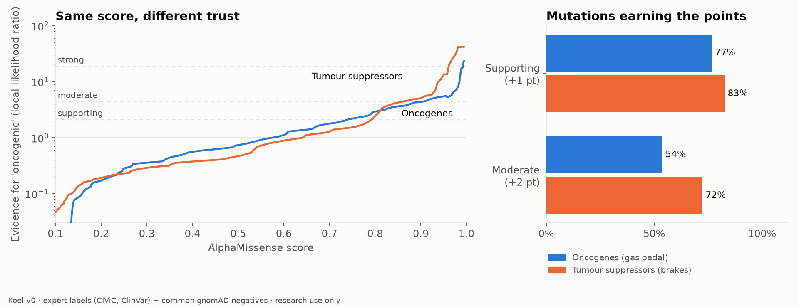
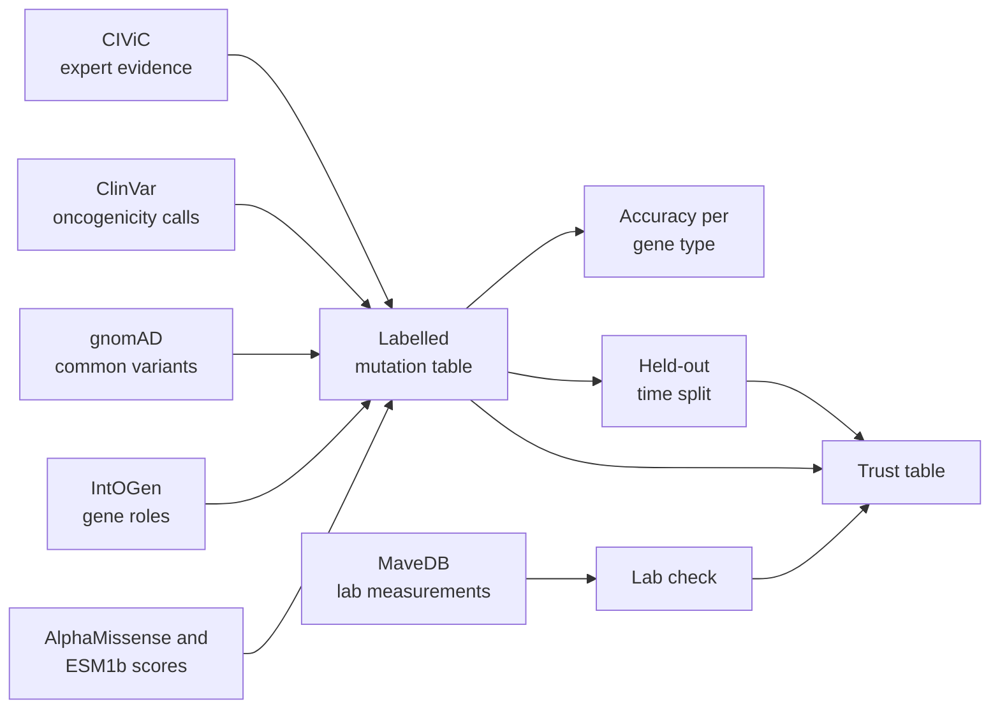

<div align="center">

# Koel

**An open trust checker for cancer mutation scores**

*How much should you trust an AI "is this mutation harmful?" score?
It depends on the gene. Koel measures how much.*

[](https://github.com/notaaaronfr/koel/actions/workflows/ci.yml)
[](LICENSE)
[](pyproject.toml)
[](#data-and-licences)
[](#research-use-only)

[The problem](#the-problem-in-30-seconds) ·
[Results](#results-so-far) ·
[Quick start](#quick-start) ·
[How it works](#how-it-works) ·
[Roadmap](#roadmap) ·
[Get involved](#get-involved)

</div>

<picture>
  <source media="(prefers-color-scheme: dark)" srcset="docs/figures/trust_curve_dark.png">
  
</picture>

## The problem in 30 seconds

- A tumour DNA test often finds mutations nobody has seen before. Most are labelled
  **"variant of uncertain significance"**: no one knows if they drive the cancer.
- AI predictors such as **AlphaMissense** and **ESM1b** give every possible mutation a
  "how harmful" score, and experts may count that score as evidence.
- But genes cause cancer in two ways. **Tumour suppressors** (the brakes) fail when a
  mutation *switches them off*. **Oncogenes** (the gas pedal) cause cancer when a
  mutation *switches them on*. Predictors are mostly good at spotting "switched off".
- The official rules ([ClinGen/CGC/VICC, Horak et al. 2022](https://doi.org/10.1016/j.gim.2022.01.001),
  criterion OP1) give a predictor score the **same weight in every gene**.

**Koel measures, openly and reproducibly, how much weight a score has actually earned,
separately for each predictor and each gene type.**

## Results so far

> v0 numbers, research use only. Every number here is re-created by `uv run koel all`.

### 1. The trust table

The AlphaMissense score that earns each level of evidence (one-sided 95% bootstrap
bound on local likelihood ratios; [method](src/koel/calibrate.py)):

| Evidence level | Oncogenes (gas pedal) | Tumour suppressors (brakes) |
|---|---|---|
| Supporting (+1 point) | score ≥ **0.885**, reached by 77% of cancer mutations | score ≥ **0.830**, reached by 83% |
| Moderate (+2 points) | score ≥ **0.982**, reached by 54% | score ≥ **0.943**, reached by 72% |
| Benign supporting (−1 point) | score ≤ 0.269 | score ≤ 0.284 |

**In oncogenes the same evidence needs a higher score, and fewer real cancer mutations
get there.** Thresholds re-learnt without any mutation classified after AlphaMissense
was released held up on those held-out mutations at both levels.
The full table (including ESM1b) is written to `data/processed/trust_table.csv`.

### 2. Held-out test: mutations classified after AlphaMissense came out

361 ClinVar oncogenic calls made on or after 19 Sep 2023, none of them in CIViC:

| AlphaMissense ≥ 0.792 | Oncogenes | Tumour suppressors |
|---|---|---|
| Cancer mutations caught | 81% (95% CI 74–87%) | 86% (81–90%) |
| Common harmless variants wrongly flagged | 6.0% | 3.7% |

Same direction as the trust table, but the confidence intervals overlap. That is why
Koel reports evidence strengths with bounds, not single accuracy numbers.

### 3. Against lab measurements

About 10,800 mutations measured in the lab (deep mutational scans via MaveDB, CC0):

| Gene | AlphaMissense AUROC | ESM1b AUROC |
|---|---|---|
| TP53 | 0.93 | 0.84 |
| PTEN | 0.89 | 0.85 |
| BRCA1 | 0.90 | 0.85 |

All three are tumour suppressors. **No large open lab dataset for an oncogene is in Koel
yet. That is the most useful thing a collaborator could bring.**

### Known limitations

- Most "benign" examples are common variants from healthy people (gnomAD). Predictors
  saw similar data in training, so these numbers are **optimistic**.
- Some ClinVar curators may have looked at AlphaMissense when classifying.
- A few hundred expert-labelled mutations per gene type, so intervals are wide.

## Quick start

Needs [uv](https://docs.astral.sh/uv/) and about 3 GB of disk. No GPU.

```bash
git clone https://github.com/notaaaronfr/koel.git && cd koel
uv sync
uv run koel download all        # open data sources (about 2.5 GB)
uv run koel all                 # build the table and run every analysis
```

Or one step at a time:

| Command | What it does |
|---|---|
| `uv run koel download --list` | show every data source, size and licence |
| `uv run koel table` | build the labelled mutation table |
| `uv run koel analyse` | accuracy (AUROC) per gene type |
| `uv run koel lab` | compare with lab-measured function |
| `uv run koel timesplit` | held-out test on calls made after AlphaMissense |
| `uv run koel trust` | the trust table |
| `uv run --group figures koel figures` | redraw the README chart |

Outputs go to `data/processed/`.

## How it works



| Module | Role |
|---|---|
| [`sources.py`](src/koel/sources.py) | every data source, URL and licence |
| [`table.py`](src/koel/table.py), [`enrich.py`](src/koel/enrich.py) | join labels, gene roles and scores |
| [`mave.py`](src/koel/mave.py) | lab-measured labels from MaveDB |
| [`analysis.py`](src/koel/analysis.py) | AUROC, lab comparison, time split |
| [`calibrate.py`](src/koel/calibrate.py) | trust table (likelihood ratios to evidence points) |

## Data and licences

Only openly licensed data. No controlled-access or patient-identifiable data, ever.

| Source | Used for | Licence |
|---|---|---|
| [CIViC](https://civicdb.org) | expert evidence | CC0 |
| [ClinVar](https://www.ncbi.nlm.nih.gov/clinvar/) | somatic oncogenicity calls | public domain |
| [gnomAD v4](https://gnomad.broadinstitute.org) | common variants as negatives | open access |
| [IntOGen](https://www.intogen.org) | oncogene / tumour suppressor roles | CC0 |
| [MaveDB](https://www.mavedb.org) | lab measurements | CC0 (checked per dataset) |
| [AlphaMissense](https://github.com/google-deepmind/alphamissense) | predictor scores | CC BY-NC-SA 4.0 |
| [ESM1b scores](https://huggingface.co/spaces/ntranoslab/esm_variants) | predictor scores | CC BY-NC 4.0 |

Data files are downloaded, never committed. Koel's **code** is MIT licensed. Any
**output that contains predictor scores** inherits their non-commercial licences.

## Roadmap

- [x] Open, reproducible data pipeline
- [x] Accuracy per gene type, lab comparison, held-out time split
- [x] Trust table v0 (AlphaMissense, ESM1b)
- [ ] More predictors, where their licences allow
- [ ] Lab data for oncogenes (activating deep mutational scans)
- [ ] Expert-confirmed benign labels to replace population negatives
- [ ] Website: gene pages, mutation lookup, predictor leaderboard, downloads
- [ ] Trust tables as files that PCGR, VEP and cBioPortal can load
- [ ] Preprint

## Get involved

Koel is built in the open. Especially welcome:

- **Variant curators and molecular pathologists:** does the trust table match how
  you weigh OP1 in practice? What would make it usable?
- **Cancer biologists:** open lab datasets for **oncogenes**, or expert-confirmed
  benign somatic variants.
- **ML and statistics people:** better calibration, more predictors, stronger tests.

Open an [issue](https://github.com/notaaaronfr/koel/issues), or see
[CONTRIBUTING.md](CONTRIBUTING.md).

## Prior work

Koel builds on, and does not claim discovery of, the predictor gap reported in
Lee, *An openly licensed benchmark and per-gene calibration map for missense
pathogenicity predictors on activating cancer drivers*, bioRxiv (23 Jul 2026),
[doi:10.64898/2026.07.16.739080](https://doi.org/10.64898/2026.07.16.739080).
Calibration follows Tavtigian et al. 2018 and Pejaver et al. 2022.

## Citation

If Koel helps your work, please cite it using [CITATION.cff](CITATION.cff)
(GitHub's **Cite this repository** button).

## Research use only

Koel does not interpret any individual patient's results and must never be used to make
diagnosis or treatment decisions. Talk to a qualified clinician about any test result.
